# GR00T 2 技术学习笔记

作者：[ajxdhe](https://github.com/ajxdhe)

[返回简介](README.md)

GR00T 2 将未来视频预测与机器人动作生成放在同一个模型中，利用人类视频、手持设备示范和机器人数据学习操作。本文从模型结构出发，逐步解释数据如何参与训练、技能如何跨身体迁移，以及强化学习、智能体和控制系统怎样共同支持机器人执行任务，并结合近期研究讨论 System 2、System 1 与 System 0 的分工。

本文依据 NVIDIA 白皮书 *GR00T 2: Scaling Robot Foundation Models for Generalization, Dexterity, and Adaptation*，按“模型—数据—适应—执行—评估与部署”的顺序展开。GR00T 2 部分的页码、图号和表号对应 NVIDIA 白皮书，配图取自官方 PDF；延伸讨论中的其他研究另行注明出处与实验条件。实验结果与基于结果的分析分别说明。

[官方白皮书](https://research.nvidia.com/labs/gear/gr00t-2/assets/gr00t2_whitepaper.pdf) · [项目主页](https://research.nvidia.com/labs/gear/gr00t-2/)

## 1. 从“会做一个任务”到“能迁移一类经验”

设想机器人要把滤纸放进滤杯。它需要认出物体、展开滤纸、调整手指接触的位置，再把柔软的纸放到合适的位置。换一只手、换一个相机角度，原来的轨迹就可能不再适用。即使知道每一步该做什么，执行时仍可能因为抓得太浅或接触位置不对而失败。

这也是阅读 GR00T 2 时需要区分的三件事：知道任务的步骤、在当前身体上完成动作，以及在出错后继续完成任务。它们对应不同的学习与控制问题。

### 1.1 VLA 已经带来了什么，还缺什么

VLA 是 Vision-Language-Action，即视觉—语言—动作模型。它把相机观察和语言指令接到动作输出上，使机器人能够利用大规模预训练，再通过机器人数据学习操作。白皮书是在这条路线之上继续推进，并没有证明所有 VLA 都缺乏对物理变化的理解。

论文更关心的是：机器人数据昂贵，人类视频却很多，怎样让这些经验共同帮助动作学习？从一种机器人学到的技能，能否迁移到另一种手和机械臂？只补几条示范，能否完成适应？对插接、装配这样的精细任务，又能否通过执行反馈继续提高成功率？这些问题共同构成了 GR00T 2 的出发点。[原文 §1，第 3–5 页](https://research.nvidia.com/labs/gear/gr00t-2/assets/gr00t2_whitepaper.pdf#page=3)

### 1.2 WAM 把未来画面和动作放进同一个模型

GR00T 2 采用 World-Action Model，简称 WAM，世界—动作模型。给定当前观察、身体状态和任务指令，模型联合预测接下来的视频与动作。

对学习者来说，可以把它理解为：训练时既要求模型给出动作，也要求模型学习场景会怎样随操作变化。视频提供可见变化的监督，动作提供身体如何运动的监督，两者共享主要网络。这里的“世界模型”具体落在未来视觉预测上；仅凭这个名称，不能推断模型已经具备完整物理规律或任意长程规划能力。

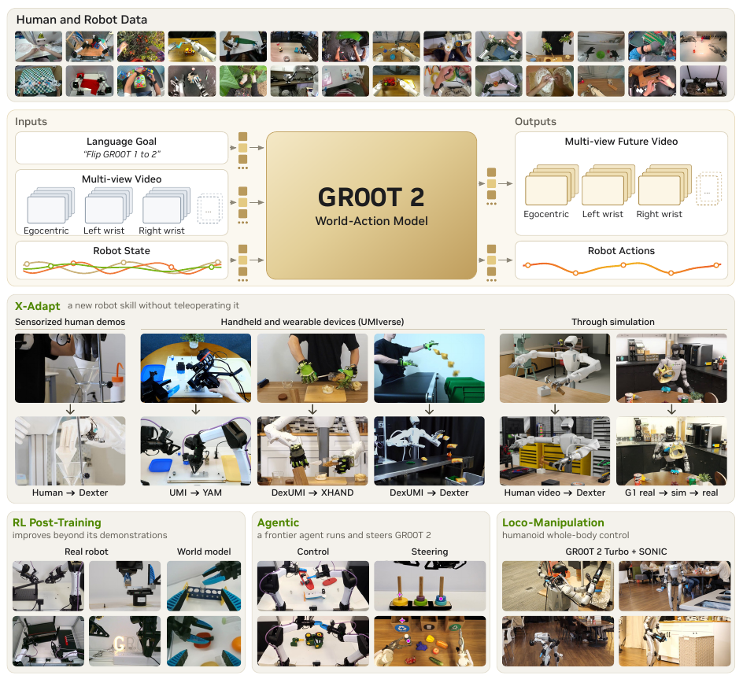

*Figure 1 · NVIDIA GR00T 2 白皮书第 4 页原图（从官方 PDF 裁切）*

读 Figure 1 时，先看数据怎样汇入共享模型，再看模型如何面向不同机器人输出动作。后文将依次回答这两条路径上的问题：数据如何对齐，动作又如何落到具体身体上。[Figure 1，第 4 页；§2，第 5–6 页](https://research.nvidia.com/labs/gear/gr00t-2/assets/gr00t2_whitepaper.pdf#page=4)

### 1.3 这篇论文的贡献怎样连起来

GR00T 2 的模型设计，让未来视频和动作能够联合学习；训练流程把人类视频、穿戴设备示范与机器人操作放到共同的训练过程中；迁移和少样本实验检查这些经验能否被新身体利用；强化学习、智能体和运行时优化则继续处理精细执行、长任务和计算延迟。

因此，理解这篇论文需要同时关注模型、数据和系统。后面的实验也应分别对应到它们所检验的能力，不能把一个任务的高成功率直接视为整个机器人系统已经可靠。

## 2. 机器人每次生成动作时，模型里发生了什么

### 2.1 输入里既有画面，也有身体状态

标准 GR00T 2 接收约 0.8 秒的历史图像，图像以 5 fps 输入，分辨率为 224 × 320，最多使用四路相机。常见配置包括头部相机和双腕相机。机器人还提供自身状态，例如关节状态，并接收语言指令。

“本体状态”描述机器人自己的身体；“动作”则是接下来要执行的控制目标。不同机器人具有不同的关节、手指和控制接口，这些差别需要专门的输入、输出模块来处理。论文把这种身体及其感知、动作空间的差别称为 embodiment。[§2，第 5–6 页](https://research.nvidia.com/labs/gear/gr00t-2/assets/gr00t2_whitepaper.pdf#page=5)

| 信息 | 怎样进入模型 | 在学习中起什么作用 |
| --- | --- | --- |
| 多相机历史图像 | 经冻结的 Wan2.1 VAE 压缩为视频潜变量，再加入相机视角标识 | 提供物体位置、手与物体的关系、近期变化 |
| 语言指令 | 由冻结的 Cosmos-Reason1 编码，通过交叉注意力接入 | 指定当前任务 |
| 机器人状态 | 经对应身体的小型 MLP 映射为 token | 告诉模型身体当前处于什么状态 |
| 待生成的动作 | 以带噪声的动作 token 参与联合生成，再由对应身体的动作头解码 | 得到这台机器人的控制输出 |

token 可以先理解为网络处理的一个向量单元。VAE 把图像压缩到更小的“潜变量”空间，模型在这个空间中预测视频，减少直接处理像素的计算量。标准模型的 VAE 在时间上压缩 4 倍、空间上压缩 8 × 8 倍，每个相机的一个潜变量帧对应 280 个 token。这些数字解释了为什么视频表示会显著影响推理成本。[§2，第 5 页](https://research.nvidia.com/labs/gear/gr00t-2/assets/gr00t2_whitepaper.pdf#page=5)

### 2.2 视频和动作怎样共同生成

模型基于 Cosmos-Predict2.5-2B，主要网络是约 20 亿参数的 Transformer。视频 token 可以跨时间、跨相机建立联系；动作 token 可以关注视频 token，其中包括正在生成的未来视频。

训练使用联合的视频与动作 flow matching 损失。第一次接触 flow matching 时，可以把它看作学习一条从噪声走向数据的生成路径：模型预测沿着这条路径该如何更新，推理时经过少量更新，得到视频潜变量和动作。GR00T 2 把两种输出放在同一套主要网络中训练。

这为“视觉变化如何帮助动作”提供了具体连接，但还不足以证明机器人在每次执行前都会显式比较多个未来并选择最优方案。论文展示的是联合预测结构及其整体效果，视频预测在其中究竟承担了多少表示学习、监督或推理作用，仍需进一步拆分实验。[§2，第 5–6 页；§5，第 26 页](https://research.nvidia.com/labs/gear/gr00t-2/assets/gr00t2_whitepaper.pdf#page=5)

### 2.3 一次输出一段动作，再根据新观察继续生成

GR00T 2 输出的是 action chunk，即一段连续动作。底层控制器执行这些动作时，模型可以准备下一段预测。这形成了一个反复运行的过程：读取观察 → 预测动作段 → 执行 → 获取新观察。

标准部署中，视频通常使用 1–2 次去噪更新，动作用 2–4 次。减少更新次数能节省计算，但是否损害技能，需要在具体任务上验证。动作段之间的衔接也不能只靠“模型算得更快”解决，第六节会继续讨论实时分块和底层控制。[§2，第 6 页；§4.6，第 23–24 页](https://research.nvidia.com/labs/gear/gr00t-2/assets/gr00t2_whitepaper.pdf#page=6)

## 3. 这些能力从什么数据里学来

模型结构说明了信息可以怎样连接，训练过程才决定这种连接实际学到了什么。GR00T 2 的数据既有大规模人类活动，也有能够对应到机器人动作的示范。

### 3.1 三个训练阶段各自补上什么

| 阶段 | 主要训练内容 | 学习时应关注的作用 |
| --- | --- | --- |
| 单视角视频预训练 | 以人类视频为主，辅以机器人视频，学习未来视频预测 | 先学习丰富的物体交互和场景变化 |
| 多视角联合训练 | 加入多相机观察、各身体的状态和动作模块，联合训练视频与动作；人类数据中的手部跟踪也可提供动作监督 | 将视觉变化与不同身体的动作联系起来 |
| 机器人数据加权训练 | 提高机器人数据，尤其是 YAM 数据的权重，同时保留其他来源 | 进一步适应机器人执行的分布 |

这三个阶段逐步加强了视觉经验与机器人动作的联系。人类数据也可以包含动作监督：论文通过手部跟踪获得姿态轨迹，在有效监督可用时计算动作损失。[§4.1，第 14 页](https://research.nvidia.com/labs/gear/gr00t-2/assets/gr00t2_whitepaper.pdf#page=14)

训练数据包括过滤后的 Human-1M 人类视频约 402,730 小时、UMI 数据约 10,184 小时，以及机器人数据约 23,500 小时。Human-1M 的完整数据集规模为一百万小时，GR00T 2 使用的是经过过滤的子集。UMI 是把相机等传感器装到手持示范装置上的采集方式，示范者移动装置完成任务，不必每次都遥操作目标机器人。不同来源能提供的监督不同，时长相加并不能代表它们具有相同的训练价值。[§4.1–4.2，第 14–16 页](https://research.nvidia.com/labs/gear/gr00t-2/assets/gr00t2_whitepaper.pdf#page=14)

### 3.2 人类视频增加后，机器人是否真的受益

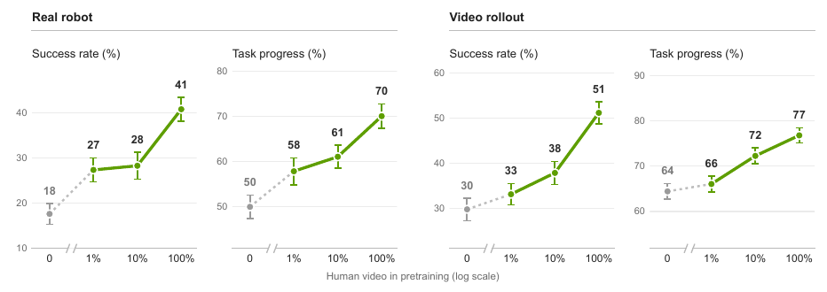

*Figure 10 · 不同人类视频用量下的真机与视频预测表现（NVIDIA 白皮书第 15 页原图）*

Figure 10 把人类数据用量与真机表现联系起来。在图中的四种配置下，真机成功率分别为 18%、27%、28% 和 41%。评估包含 72 个任务、每个任务三次尝试。图中的任务进度与二元成功率是不同指标：前者反映做到哪一步，后者要求完成任务。

理解这个结果需要看训练条件：0% 配置跳过共享的人类预训练；1%、10%、100% 配置共享预训练初始化，随后按各自人类数据份额训练，机器人数据的训练安排保持一致。数据用量变化也伴随着计算量变化。因此，这支持“该训练方案下，增加人类数据有助于机器人表现”，还不能单独给出人类数据与机器人数据的精确替代比例。[Figure 10 及正文，第 15 页](https://research.nvidia.com/labs/gear/gr00t-2/assets/gr00t2_whitepaper.pdf#page=15)

### 3.3 一段人类示范怎样变成机器人能学的动作

以放滤纸为例，难点不只是人的手与机器人的手长得不同。相机位置、手指结构、腕部坐标和运动速度也不一样。论文使用专门的采集与重定向流程来缩小这些差异。

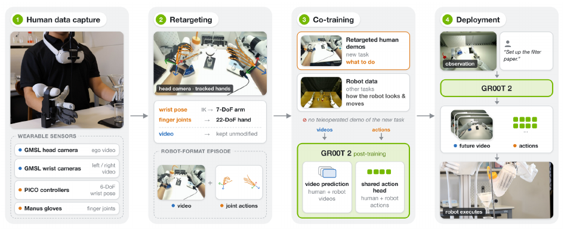

*Figure 12 · 从人类示范到 Dexter 放滤纸的训练流程（NVIDIA 白皮书第 18 页原图）*

采集时，头部和腕部相机尽量对应机器人视角，腕部跟踪器记录运动，数据手套记录手指姿态。重定向时，将腕部运动映射到机械臂，将手指运动映射到 Sharpa 手，尽量保持指尖之间的几何关系。训练时，再把人类任务示范与目标机器人的通用操作数据混合；后者让模型学习这具身体实际怎样运动。

这条流程中，人类视频仍是人手画面，动作则经过重定向，目标机器人数据负责补充身体经验。“任务示范来自人类”因而不等于“完全不需要目标机器人的任何数据”。在该实验配方中，人类任务数据与目标机器人的 task-agnostic play data 按 1∶1 混合。[§4.4，第 18 页；附录 B.1，第 42–46 页](https://research.nvidia.com/labs/gear/gr00t-2/assets/gr00t2_whitepaper.pdf#page=18)

放滤纸的任务包括展开、放置和润湿等六个阶段。使用人类任务示范时，GR00T 2 在 20 次评估中成功 13 次，即 65%；加入 10 条目标机器人的任务遥操作示范后达到 95%。论文还提供了其他模型及去掉跨身体预训练的对照。这里支持的结论是：对齐后的示范与已有跨身体经验能够帮助迁移，而少量目标身体示范仍能明显改善结果。[附录 B.1、Figure 27，第 46 页](https://research.nvidia.com/labs/gear/gr00t-2/assets/gr00t2_whitepaper.pdf#page=46)

### 3.4 其他示范方式怎样接入同一个模型

论文还研究了几种迁移路线，它们减少目标任务遥操作的方式并不相同。

| 数据路线 | 需要跨越的差别 | 关键处理 |
| --- | --- | --- |
| UMI → YAM 夹爪机器人 | 手持设备与机器人本体不同 | 结合通用 YAM 数据训练，把装置示范接到机器人动作上 |
| DexUMI → 灵巧手平台 | 多指动作、接触与手型差异更复杂 | 使用外骨骼和力相关记录；是否需要额外机器人数据取决于目标手型和映射条件 |
| 人类视频 → 仿真 → 真机 | 单段视频难以直接提供完整控制监督 | 重建场景与运动，在仿真中训练专家，生成随机化轨迹，再训练 WAM |

这些路线共同说明，迁移效果依赖数据接口的设计。读“无需目标机器人遥操作”时，应继续看它指的是任务专用示范，还是所有目标机器人数据，以及是否使用了通用操作数据或仿真训练。[Figure 4，第 8 页；§4.4，第 18–20 页](https://research.nvidia.com/labs/gear/gr00t-2/assets/gr00t2_whitepaper.pdf#page=8)

数据和动作建立了连接后，下一步要检验的是：换一具身体时，这种连接能保留多少，又需要多少新示范才能补齐差距。

## 4. 从跨身体迁移到少样本适应

### 4.1 先明确“零样本”相对于什么

Dexter 是双臂、双灵巧手平台。Dexter-50 中的任务没有出现在 Dexter 的训练数据里，却出现在 YAM 夹爪遥操作数据、人类视频或两者之中。这里的零样本，是没有为 Dexter 提供这些任务的专用示范；模型仍有其他身体上的相关任务经验。

少样本设置从同一预训练模型出发，为每项任务增加 1 条或 5 条 Dexter 遥操作示范。它测试的是：已有经验能否减少新身体所需的适应数据。[附录 A.3，第 41 页](https://research.nvidia.com/labs/gear/gr00t-2/assets/gr00t2_whitepaper.pdf#page=41)

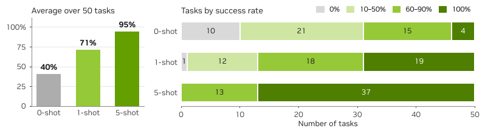

*Figure 2 · Dexter-50 的零样本与少样本结果（NVIDIA 白皮书第 6 页原图）*

Figure 2 的平均成功率为：零样本 40%，一条示范 71%，五条示范 95%。在五条示范设置下，50 个任务中的 37 个在所做的评估尝试中全部成功。“评估中全部成功”仍然是有限次数的观测，不能改写成以后每次都能成功。

还有一个决定如何解读结果的条件：Figure 24 的图注说明，这 50 个任务被选为“五条示范后成功率至少达到 80%”的任务。因此，95% 描述的是这组可被少样本适应学会的任务，不能当成任意新任务的预期成功率。[Figure 2，第 6 页；附录 A.3，第 41 页；Figure 24，第 42 页](https://research.nvidia.com/labs/gear/gr00t-2/assets/gr00t2_whitepaper.pdf#page=42)

### 4.2 五条示范具体改了哪些参数

少样本训练使用 LoRA。可以把它理解为：冻结原有大部分参数，训练附加的小型低秩参数更新，训练结束后再把更新合并进原权重。

论文在 Transformer 的每个线性层上训练 rank-32 LoRA，冻结原始权重、文本编码器、视频 VAE，以及状态与动作头。训练仍采用联合的视频和动作 flow matching 损失。这个细节说明，适应过程继续利用视频与动作之间的联系，并非只调整最后的动作输出层。

每条示范被切成 100 个均匀分布的训练窗口；根据冻结模型在各窗口上的损失加权采样，使训练更多关注原模型尚未掌握的片段。所有任务共用超参数，不逐任务调参。一次训练约需一张 RTX 5090 上的 30 分钟，五条示范的数据采集时间可少于三分钟。[§3.1，第 6 页；附录 A.3，第 41 页](https://research.nvidia.com/labs/gear/gr00t-2/assets/gr00t2_whitepaper.pdf#page=41)

### 4.3 怎样理解少量数据带来的大幅提升

论文给出的失败例子中，零样本模型往往已经选择了合理的任务步骤，却在提壶盖、打开抽绳袋等具体环节失败。少量 Dexter 示范可以补充当前手型所需的接触和动作信息。[Figure 25，第 43 页](https://research.nvidia.com/labs/gear/gr00t-2/assets/gr00t2_whitepaper.pdf#page=43)

从这些例子可以形成一种学习上的解释：跨身体预训练提供了可复用的任务经验，新示范帮助模型适应当前身体的执行细节。但这不是对所有任务都成立的分解定理，也不能据此认为模型已把“任务知识”和“身体知识”完全分开。

另外，白皮书中有几套不同的评估，数字不能互相替换：

| 评估 | 它在检查什么 | 主要条件 |
| --- | --- | --- |
| Dexter-50 | 跨身体零样本与少样本迁移 | 50 个经过可适应性筛选的任务；0、1、5 条任务示范 |
| Table 3 的 Dexter 零样本评估 | 较广的操作与指令泛化 | 71 个任务，每任务三次；模型交错执行，成功判定者不知道模型身份 |
| Figure 10 的人类数据消融 | 人类数据用量对训练结果的影响 | 72 个任务，每任务三次；比较不同训练配置 |

这三组结果分别回答迁移、泛化和数据配方的问题。它们的任务集合、训练条件和研究目的不同。[Table 3、附录 A.3，第 41 页；Figure 10，第 15 页](https://research.nvidia.com/labs/gear/gr00t-2/assets/gr00t2_whitepaper.pdf#page=41)

少样本适应仍主要学习示范。面对插接、装配中反复出现的细小偏差，还需要让模型从自己的执行结果中学习。

## 5. 从模仿到试错，再到完整任务

### 5.1 强化学习怎样改善接触操作

SFT，即监督微调，让模型学习示范中的动作。对精细接触任务，示范提供了可行操作，但机器人执行时的微小偏差仍会累积。强化学习进一步使用机器人自己尝试后的成功与失败，调整动作生成策略。

GR00T 2 使用 CPS 给动作生成过程加入探索噪声。它将新增随机性限制在实际执行的动作坐标上；视频去噪在初始潜变量给定后保持确定性。这样，尝试主要改变机器人的动作，而不会在每个去噪步骤同时随机扰动视频分支。[附录 F.1、Figure 46，第 84–85 页](https://research.nvidia.com/labs/gear/gr00t-2/assets/gr00t2_whitepaper.pdf#page=84)

随后，GRPO 将同一任务和场景布局下的多次尝试放在一组，按任务是否成功获得 0 或 1 的回报，再比较各次尝试相对于基线的表现。论文还保留这个场景过去的平均回报：如果本轮全失败、过去却曾成功，仍可得到退步的学习信号；反过来也一样。历史信息改善了组内结果相同的情形，但不会凭空给首次遇到且全部失败的任务提供成功动作。[附录 F.1，第 85–86 页](https://research.nvidia.com/labs/gear/gr00t-2/assets/gr00t2_whitepaper.pdf#page=85)

### 5.2 自模仿把成功探索重新变成训练数据

论文比较了几种后训练方式，需要分清它们更新的对象。

| 方法 | 怎样学习 |
| --- | --- |
| Residual RL | 冻结 GR00T 2，另学一个策略对它的动作作修正 |
| GRPO | 利用执行回报，直接更新 GR00T 2 |
| GRPO-induced self-imitation | 收集 GRPO 策略的成功轨迹，再用监督训练学习这些轨迹 |

自模仿使用的成功轨迹，来自训练最佳 GRPO 检查点所用的全部 rollout。筛选完成后，模型从与 GRPO 相同的 SFT 初始权重出发，采用原有的视频与动作目标进行监督训练，无需额外采集机器人轨迹。由此，GRPO 探索得到的成功行为又成为新的示范，供监督学习吸收。[附录 F.1，第 86 页](https://research.nvidia.com/labs/gear/gr00t-2/assets/gr00t2_whitepaper.pdf#page=86)

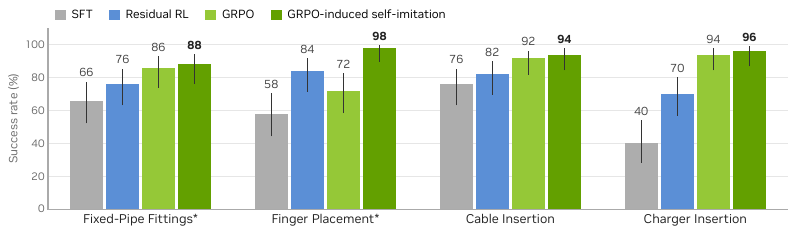

*Figure 5 · 四项真机精细操作的强化学习结果（NVIDIA 白皮书第 10 页原图）*

| 任务 | SFT | GRPO | GRPO 产生数据后的自模仿 |
| --- | --- | --- | --- |
| Fixed-Pipe Fittings | 66% | 86% | 88% |
| Finger Placement | 58% | 72% | 98% |
| Cable Insertion | 76% | 92% | 94% |
| Charger Insertion | 40% | 94% | 96% |

每根柱子来自 50 次评估，误差线为 95% Wilson 区间；前两项任务按图注使用 CPS 采样噪声。结果显示，在这些接触任务上，执行反馈能够继续改善 SFT 策略，而成功轨迹的监督学习也很有效。94% 与 96% 这样的差别不能仅凭点估计断言显著。[Figure 5，第 10 页](https://research.nvidia.com/labs/gear/gr00t-2/assets/gr00t2_whitepaper.pdf#page=10)

### 5.3 局部动作变好以后，谁来组织长任务

会插好一个零件，还不等于会完成一次装配。完整任务还需要决定先后顺序、记住已经完成的步骤、发现掉落的零件，并判断是否需要重新尝试。

GR00T 2 的智能体系统把这些任务层面的工作交给上层多模态智能体。智能体读取观察、推理下一步、调用工具，并检查结果；GR00T 2 负责具体的操作技能。系统还提供 CaP，即 Code as Policies，通过程序调用定位、运动规划、夹爪控制等工具来完成适合显式编排的动作。[§3.4，第 10–12 页](https://research.nvidia.com/labs/gear/gr00t-2/assets/gr00t2_whitepaper.pdf#page=10)

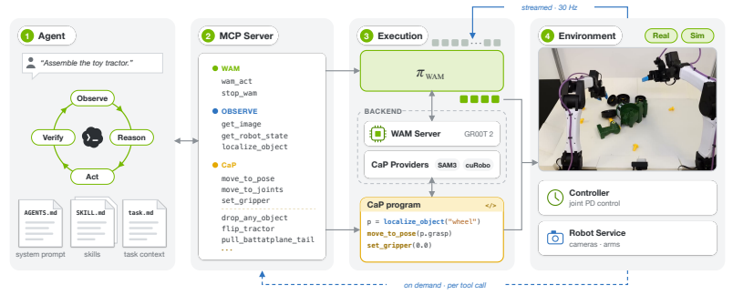

*Figure 6 · 智能体、工具接口与执行后端（官方 PDF 第 10 页原图）*

在真机装配设置中，GR00T 2 是主要执行方式；如果出现掉件或进度停滞，上层智能体可调用 CaP 恢复场景，然后交回 GR00T 2。接口提供 wam\_act 和 stop\_wam 等工具，并协调控制权，避免两个执行过程同时向机器人发指令。仿真设置中的后端选择有所不同，不能把所有实验都概括成同一种运行方式。[Figure 6，第 10 页；附录 G，第 98–102 页](https://research.nvidia.com/labs/gear/gr00t-2/assets/gr00t2_whitepaper.pdf#page=98)

三项杂乱场景装配实验分别得到 98/100、97/100 和 97/100 次成功，需要人工干预的尝试计为失败。这是经过后训练、数据聚合和智能体辅助的完整系统结果，不能归给裸模型一次动作预测。精细技能质量同样重要：在同一智能体框架下，五次线缆插入任务由 SFT 的 12/20 提升至 RL 策略的 19/20，五次充电器插入由 2/20 提升至 20/20。[§3.4，第 11 页；附录 G，第 101–102 页](https://research.nvidia.com/labs/gear/gr00t-2/assets/gr00t2_whitepaper.pdf#page=11)

这些结果说明，上层组织与底层技能相互依赖。上层能够重试和恢复，前提是底层有相应的可执行技能；底层技能成功率提高，长序列任务才不容易在中途反复失败。

### 5.4 视觉引导如何补充语言指令

对于“拿这里的物体，放到那里”这样的指令，文字可能无法精确表达目标位置。论文测试的视觉引导接口，允许智能体在当前相机画面上指定抓取点和释放点，并配合当前步骤的语言指令。GR00T 2 负责完成这些目标之间的实际操作。

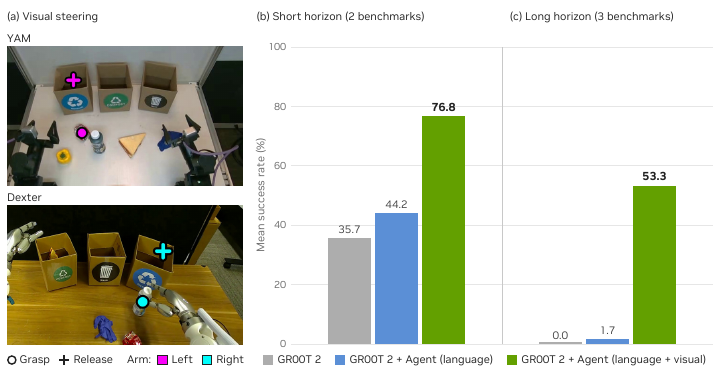

*Figure 8 · 用抓取点和释放点引导机器人（NVIDIA 白皮书第 12 页原图）*

读 Figure 8 时，应注意它展示的是带标记点的视觉输入。模型为这个接口接受了额外的中间训练，训练目标点由动作事件等信息自动生成。它不是在原模型上随意画点就立即获得的新能力，也不能直接扩展为“任意目标图片都可以驱动机器人”。

图中，从智能体仅用语言引导到加入视觉引导，短任务平均成功率由 44.2% 提升至 76.8%，长任务由 1.7% 提升至 53.3%。这里对各基准等权平均，并非合并所有尝试计算成功率。短任务的两组评估分别有 144 次和 64 次尝试，其中 Dexter 使用较早的模型实现；长任务的三组评估分别有 20、20 和 10 次。YAM 和 Dexter 垃圾分类实验还使用了数据、相机、训练安排和计算量匹配的语言基线。视觉点增强了“在哪儿操作”的表达，但抓取方向、接触力和如何完成装配，仍依赖底层策略。[Figure 8，第 12 页；附录 G.2，第 102–104 页](https://research.nvidia.com/labs/gear/gr00t-2/assets/gr00t2_whitepaper.pdf#page=12)

本节几项技术形成了连续关系：示范给出起始技能，执行反馈改善精细动作，成功轨迹可再次用于训练，上层智能体再把这些技能组成完整任务。系统最终能否稳定工作，还要通过评估和实际运行来检验。

## 6. 怎样知道模型更好，以及怎样让它持续运行

### 6.1 真机评估先控制场景差异

机器人实验容易受初始摆放、操作者、工作站和日期影响。如果两个模型在不同条件下测试，成功率变化可能不全来自模型。

论文的 GearArena 使用盲测和成对比较：让待比较模型在尽量一致的场景和时间条件下交错运行，判定者不知道模型身份，再汇总胜负或任务进度。Elo 等相对评分帮助比较多个检查点，但仍需要共享参照和明确的任务集合。[§4.3，第 16–17 页](https://research.nvidia.com/labs/gear/gr00t-2/assets/gr00t2_whitepaper.pdf#page=16)

这里还要分清两个指标。任务进度回答“完成了多少步骤”，任务成功回答“是否达到了完整验收条件”。如果机器人把螺丝旋进去一半，进度可以很高，任务仍然失败。判断系统改进时，需要同时看这两个量，尤其不能用视觉上接近完成替代物理验收。

### 6.2 仿真能否帮助筛选真机模型

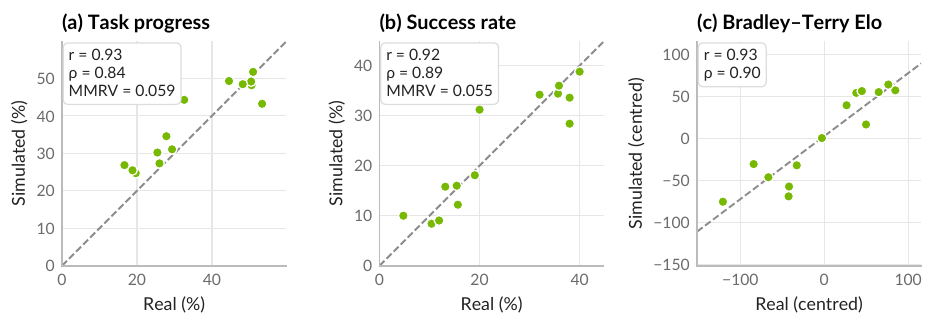

*Figure 18 · YAM 模型在仿真与真机上的表现（NVIDIA 白皮书第 21 页原图）*

Figure 18 的每个点代表一个 YAM 通用模型检查点。论文比较了 14 个检查点，在 25 个任务上进行真机和仿真评估；真机每项任务进行 5 次盲测 A/B 评估，仿真进行 10 次评估。图中的 Pearson 相关系数分别约为：任务进度 0.93、成功率 0.92、Elo 0.93。

这支持用经过校准的仿真帮助筛选这一组模型。它尚不能证明仿真对所有灵巧接触任务、所有强化学习策略或不同训练配方都同样可靠。强化学习还可能利用模拟器误差，因而需要继续做真机检验。[§4.5.2、Figure 18，第 21–22 页；§5，第 27 页](https://research.nvidia.com/labs/gear/gr00t-2/assets/gr00t2_whitepaper.pdf#page=21)

仿真在本文还有另一种用途：生成训练经验。论文另外使用经过机器人数据适配的 DreamDojo 世界模型，让策略动作推动预测场景继续变化，再用这些轨迹进行学习。这个过程需要任务相关的数据、成功判定，以及包含失败和恢复的经验。要把“用仿真评估模型”与“在世界模型里训练策略”分开理解，两者需要的可信度和验证方式并不完全相同。[§4.5.3，第 22 页](https://research.nvidia.com/labs/gear/gr00t-2/assets/gr00t2_whitepaper.pdf#page=22)

### 6.3 Turbo 主要改变了哪部分计算

GR00T 2 Turbo 仍使用约 20 亿参数的 Transformer，改用 Wan2.2 VAE，使空间压缩从 8 × 8 变为 16 × 16，视频潜变量网格缩小到原来的四分之一。动作预测范围保持不变。它降低了视频表示的计算负担，也改变了模型可保留的视觉细节。[§2，第 6 页](https://research.nvidia.com/labs/gear/gr00t-2/assets/gr00t2_whitepaper.pdf#page=6)

这种变化有任务相关的代价。Table 1 的后训练评估中，YAM 平均成功率从标准模型的 71.7% 降到 Turbo 的 65.0%，灵巧操作则从 68.6% 降到 34.3%。论文也明确指出，这个比较没有单独隔离性能下降的原因。可以据此提出“精细操作可能更依赖视觉细节”的研究问题，但不能把差距全部归因于某一个分辨率参数。[Table 1，第 7 页；§5，第 26 页](https://research.nvidia.com/labs/gear/gr00t-2/assets/gr00t2_whitepaper.pdf#page=7)

### 6.4 算得快、动作连续、任务做得快，是三项检查

| 目标 | 论文采用的手段 | 需要怎样验证 |
| --- | --- | --- |
| 缩短一次预测的时间 | 缓存重复计算、TensorRT、CUDA Graph、部分层 FP8、调整去噪步数 | 延迟与闭环任务成功率 |
| 让相邻动作段连续 | 实时分块 RTC，根据已承诺执行的动作前缀预测后续动作 | 动作平滑程度与成功率 |
| 缩短整项任务耗时 | 按运输、插入等阶段调整动作速度 | 完成时间、成功率及运动质量 |

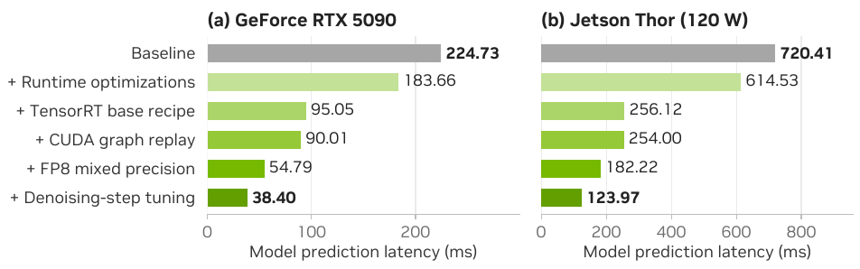

*Figure 19 · G1 Turbo 逐项优化后的预测延迟（NVIDIA 白皮书第 23 页原图）*

Figure 19 使用相同的 G1 Turbo 检查点权重和输入观察，逐项增加优化。RTX 5090 上的中位预测延迟由 224.73 ms 降到 38.40 ms，Jetson Thor 120 W 模式由 720.41 ms 降到 123.97 ms。测量在 20 次预热后进行，共 500 次预测。图中最后一步将去噪配置从“视频 2 次、动作 4 次”变为“视频 1 次、动作 2 次”。[§4.6.1、Figure 19，第 23 页](https://research.nvidia.com/labs/gear/gr00t-2/assets/gr00t2_whitepaper.pdf#page=23)

这组结果适合比较同一模型逐项优化的效果。标准 GR00T 2 在 Dexter/RTX 5090 上的延迟，与 Turbo 在 G1/Thor 上的延迟，涉及不同模型、身体和硬件，不应直接相除作为单一加速比。

RTC 处理的是计算期间机器人仍在移动的问题。新预测需要接上已经承诺执行的前一段动作。论文在微调时给条件动作前缀加高斯噪声，推理时使用实际的干净前缀，以兼顾连续性和对新观察的响应。八项 RoboDojo 精细任务的模拟延迟实验中，在 160 ms 延迟下，成功率由异步执行的 32.8% 提升至 34.8%；在 320 ms 下由 15.0% 提升至 21.4%，动作突变也减少。这些是在指定模拟延迟下的结果，不能替代全部真机运行条件的验证。[§4.6.2，第 23–24 页](https://research.nvidia.com/labs/gear/gr00t-2/assets/gr00t2_whitepaper.pdf#page=23)

任务耗时还受示范速度约束。论文为不同阶段设置不同速度：运输阶段可以更快，接触阶段更保守，并通过执行反馈修正速度安排。Figure 20 展示了这一机制。即使模型预测足够快，也仍需要检查加速后的动作是否成功、平滑。[§4.6.3、Figure 20，第 24 页](https://research.nvidia.com/labs/gear/gr00t-2/assets/gr00t2_whitepaper.pdf#page=24)

### 6.5 人形机器人为何采用分层控制

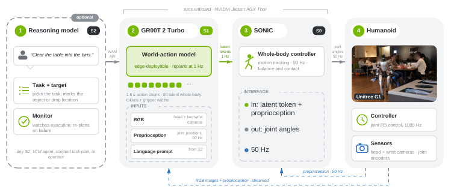

*Figure 9 · G1 的全身移动操作控制（NVIDIA 白皮书第 13 页原图）*

在 G1 上，Turbo 大约每秒预测一次，给出未来约 1.6 秒的全身运动 token；SONIC 以 50 Hz 将这些表示转换成关节目标；更底层的 PD 控制器以 1000 Hz 工作。Turbo 运行在 Jetson Thor，SONIC 使用 Orin NX。[§3.5、Figure 9，第 13 页](https://research.nvidia.com/labs/gear/gr00t-2/assets/gr00t2_whitepaper.pdf#page=13)

这几个频率对应不同职责：WAM 根据观察和任务生成一段运动，SONIC 将其转为可执行的全身关节目标，PD 控制器处理更快的底层跟踪。一次预测耗时约 124 ms，不意味着整个系统必须每 124 ms 重新规划；预测延迟、规划频率、动作覆盖时长和关节控制频率是不同量。

### 6.6 数据工程也是这套方法的一部分

联合视频—动作训练需要持续读取多相机片段，并保证图像、状态与动作在时间上对齐。论文使用 Flora 等流程切分动作、生成细粒度说明和奖励相关标签；训练侧还要处理视频解码、异步预取、数据版本和可复现的采样。

主预训练使用 1,024 张 GB300 GPU。这个规模对理解论文成本很重要，但学习者更应注意其背后的要求：数据必须能稳定送到训练设备，模型检查点必须能够追溯到具体数据和训练配置，新增机器人经验也要经过一致的处理。否则，模型表现变化就难以解释和复现。[§4.2，第 15–16 页；§4.7，第 24–26 页](https://research.nvidia.com/labs/gear/gr00t-2/assets/gr00t2_whitepaper.pdf#page=24)

## 7. 延伸讨论：System 2、System 1 与 System 0

GR00T 2 把推理智能体、操作策略和全身控制器接到一起，也让一个问题变得具体：机器人的智能应该怎样分层？2026 年，Danfei Xu、Jim Fan 和 Figure 团队从数据、表示与控制等角度讨论了这个问题。以下把个人观点、公开架构和本文分析分别说明；材料范围截至 2026 年 11 月。

### 7.1 先看每一层做什么

System 2、System 1、System 0 可以帮助理解系统分工，但它们还不是跨论文统一的模块标准。以 Figure 在 2026 年 1 月 27 日公布的 Helix 02 为例，三层具有明确的输入输出关系：

| 层级 | Helix 02 中的职责 | 向下一层交付什么 |
| --- | --- | --- |
| System 2 | 理解场景、语言和任务顺序 | 语义目标的潜在表示 |
| System 1 | 结合视觉、触觉与本体状态，生成全身动作 | 200 Hz 的关节目标 |
| System 0 | 跟踪运动目标，处理全身平衡、接触和协调 | 1 kHz 的执行器命令 |

Figure 的 System 0 是学习得到的全身控制模型，使用人类运动数据与仿真强化学习训练。以上描述属于该团队公布的架构；其中的频率也仅对应 Helix 02。[Figure：Helix 02，2026-01-27](https://www.figure.ai/news/helix-02)

名称在其他系统中可能变化。Jim Fan 在介绍 SONIC 时，把快速、反应式的全身运动能力称为 System 1；GR00T 2 白皮书的智能体章节则把上层智能体称为 System 2，把负责操作的 GR00T 2 称为 System 1。阅读时应先确认每层接收什么、输出什么、多久更新一次，再讨论它的编号。[Jim Fan：SONIC 发布帖](https://www.linkedin.com/posts/drjimfan_what-can-half-of-gpt-1-do-we-trained-a-42m-activity-7432116236899135488-jGJO)；[GR00T 2，§3.4、Figure 6，第 10 页](https://research.nvidia.com/labs/gear/gr00t-2/assets/gr00t2_whitepaper.pdf#page=10)

### 7.2 Danfei Xu：任务步骤之外，还有难以用语言表达的物理推理

在 2026 年 3 月 23 日的 ReSpark 访谈中，Danfei Xu 质疑把语言模型生成的步骤序列直接视为完整的机器人 System 2。他关注的是操作中的非语言推理，以及世界模型能否提供适合这种推理的抽象表示。这是对研究方向的判断，并非证明某一种架构已经解决了该问题。[原访谈，第 18–20 问](https://www.xiaoyuzhoufm.com/episode/69c0b0552d318777c93d1ee1)；[访谈文字整理，第 18–20 问](https://jamiewang20.github.io/articles/human-data-danfei-xu/)

他的另一条思路更容易对应到 GR00T 2。2026 年 4 月 10 日的 Stanford 讲座将人到机器人的迁移分成两个相互关联的问题：从人类经验中提取物理智能的先验，再将这些先验落实到机器人的身体上。随后，他在本人发布的讲座说明中强调，人类数据的采集能力正跑在研究前面，我们对如何利用这些数据扩展机器人能力、如何建模自然行为仍缺乏充分理解。[Stanford 官方讲座摘要](https://stanfordasl.github.io/robotics_seminar/archive/)；[Danfei Xu 本人说明](https://www.linkedin.com/posts/danfei-xu-94522133_stanford-robotics-seminar-engr319-spring-activity-7454631323819962368-hsuf)

放回本文，前一个问题对应人类视频与联合预训练，后一个问题对应视角对齐、动作重定向和目标身体适应。由此可以进一步追问：模型学到的是可迁移的物体交互关系，还是某套相机和动作轨迹的统计规律？这是本文据其研究思路提出的检查问题，需要靠跨场景、跨身体实验回答。

### 7.3 Jim Fan：把动作后果放到预训练的中心

Jim Fan 在 2026 年 2 月 4 日发表的《The Second Pre-training Paradigm》中，主张以动作条件下的未来世界状态预测，作为物理智能的重要预训练基础。他关注的推理形式也包括视觉空间中的几何和接触变化，而不局限于语言链条。同时，他留下了几个问题：未来预测怎样转成电机动作，像素重建是不是最合适的目标，以及还需要多少机器人数据。[Jim Fan 原文，2026-02-04](https://www.linkedin.com/pulse/second-pre-training-paradigm-jim-fan-xn5fc)

这条主张解释了 WAM 路线的研究动机，但不能替代对具体模型的实验验证。GR00T 2 确实联合生成未来视频与动作；它尚未单独证明性能提升有多少来自训练监督，又有多少来自推理时的未来预测。这一边界也出现在白皮书自己的开放问题中。[GR00T 2，§5，第 26 页](https://research.nvidia.com/labs/gear/gr00t-2/assets/gr00t2_whitepaper.pdf#page=26)

2026 年 11 月 10 日的 GR00T 2 发布帖中，Jim Fan 将它定位为开放的 System One 模型，并强调与前沿智能体结合，以支持物理推理和错误恢复。这表明，在这套系统设计里，可复用的操作模型与上层智能体承担互补职责。发布帖中的能力介绍仍需结合白皮书的测试条件阅读。[Jim Fan 发布帖](https://x.com/DrJimFan/status/2120186651741655428)；[原帖公开存档，Recent posts](https://xholic.ai/tools/x-profile-analytics/drjimfan/)

两人的关注点可以放在一起理解：Danfei Xu 追问人类行为里哪些物理经验能被学到、怎样落到另一具身体；Jim Fan 追问用什么预训练目标，把动作的后果纳入模型。本文的理解是，这两条思路最终会在表示上相遇——上层想达到的状态，必须能被下层策略解释成当前身体可执行的动作。

### 7.4 11 月的 VFlash：视觉规划也可以更快

2026 年 11 月公布的 VFlash 提供了一个具体例子。NVIDIA 团队将其定位为面向物理 AI 的 System-1 视觉规划：利用点、框和轨迹等视觉元素的结构，一次并行生成完整元素，减少逐个坐标 token 自回归生成的开销。[VFlash 官方项目页](https://research.nvidia.com/labs/lpr/vflash/)

从这个例子可以看出，“规划”与“慢”之间并没有固定对应关系。同样是描述未来运动，输出表示、生成方式和运行时实现都能改变它的时间成本。VFlash 是独立研究；这里用它说明分层接口的设计空间，并不把它当作 GR00T 2 白皮书已验证的组成部分。

### 7.5 回到 GR00T 2：接口决定这些能力能否配合

下面按功能对照 GR00T 2 的模块。“System 0”一栏是为了与三层架构比较所作的功能归类，白皮书并未将所有底层控制统一命名为 System 0。

| 功能层 | GR00T 2 中对应的模块 | 需要解决的接口问题 |
| --- | --- | --- |
| 任务推理，论文称为 System 2 | 多模态智能体 | 如何把任务、目标位置和完成条件传给执行层 |
| 操作技能，论文称为 System 1 | GR00T 2 / Turbo | 如何根据观察和指令生成这具身体可执行的动作 |
| 底层运动与反馈控制，可与 System 0 的职责比较 | G1 上的 SONIC 与更底层 PD 控制 | 如何跟踪运动表示，并在更快的时间尺度上执行 |

这个对照按不同实验中的模块职责组织，不能理解为白皮书已经把全部模块串成一套在所有平台上验证过的统一系统。G1 实验明确给出的频率是 Turbo 约 1 Hz、SONIC 50 Hz、PD 控制 1000 Hz；上层智能体则按任务与执行事件调用。[Figure 6，第 10 页；Figure 9，第 13 页；附录 G.2，第 103 页](https://research.nvidia.com/labs/gear/gr00t-2/assets/gr00t2_whitepaper.pdf#page=13)

从学习与系统设计的角度，还可以沿着三个接口继续思考：

1. **目标的表达是否足够？** 抓取点和释放点能够指定位置，但插接方向、接触方式和力度还需要其他信息。接口应当传递语言、视觉目标、轨迹还是力约束，取决于任务。
2. **信息能否及时到达？** 上层判断再准确，也要赶在下层需要改变动作之前完成。需要测量感知、推理、传输和执行的整体延迟，而不只看某个模型的计算时间。
3. **失败以后由谁更新？** 单次恢复可以由智能体组织；反复出现的同类错误，还应检查是否需要修改数据、适应策略或调整控制。怎样把恢复经验稳定地变成模型能力，仍是值得研究的问题。

这三点是本文基于上述材料提出的分析。System 2、System 1、System 0 的价值，在于帮助定位目标理解、动作生成和物理执行之间的责任与接口；真正需要验证的是，这些接口能否在变化的场景中持续完成任务。

### 7.6 通用大模型会不会“击穿”具身智能？

前面的分层讨论容易留下一个默认前提：任务推理由通用模型完成，动作必须交给专门的机器人模型。GPT-6 Astra 与 Claude 的近期结果，正在让这个前提变得不再稳固。这里所说的“击穿”，需要分清两个问题：通用模型能否接管更多动作决策，以及整套机器人能否在现实环境中长期、及时、可靠地工作。

截至 2026 年 11 月 15 日，Anthropic 官方可核实的版本为 **Claude Fable 5.2**，发布于 11 月 9 日；

Anthropic 在同一套运行框架下进行的内部 RoboDojo Sim 测试，给出了下面的结果。该基准要求模型根据相机图像控制仿真双臂机器人；各模型使用其最高可用推理强度。

| 模型 | Anthropic 报告的 RoboDojo Sim 得分 |
| --- | --- |
| Claude Fable 5.2 | 64.9% |
| GPT-6 Astra | 29.8% |

这是**厂商报告的仿真评估**。发布页也提供了拧瓶盖、画图等真机演示，但这些视频与表中的仿真分数属于不同证据，不能合并成一项真机成功率。[Anthropic，Hardware and robotics 小节及原始演示，2026-11-09](https://www.anthropic.com/claude-fable-and-mythos-5-2)

本文据此作出的判断是：通用模型参与动作生成已经有了具体实验依据，System 2 与 System 1 的边界可以移动。至于边界能移动多远，还必须看模型获得了什么观察、通过什么接口执行，以及允许花多少时间。

### 7.7 同一个 Astra，为什么能得到很不一样的成绩

理解这类结果，需要先认识 **harness**：连接模型与机器人的运行框架。它负责组织观察和历史、提供工具、解释模型输出，并把动作交给执行系统。看似“直接控制”的实验，仍可能由运动规划器把末端目标转换为实际运动。

11 月 11 日发布的 JustRUA 固定使用 Astra，研究这些外围设计的影响。保留完整历史、缩短每段运动、提供几何信息和坐标计算工具后，其评估集得分从 29.7 提高到 50.3，未加入专门训练的动作策略。[JustRUA，§1，第 2 页](https://arxiv.org/pdf/2611.16009#page=2)

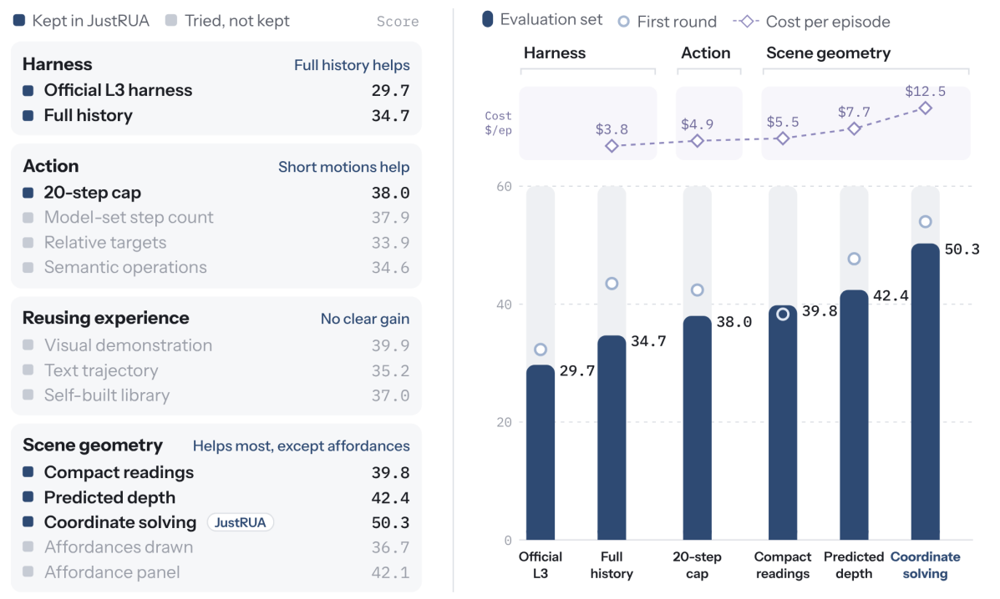

*JustRUA，Figure 1，第 1 页原图。保留原始图例、得分与成本曲线；由作者 PDF 裁切，未重绘。*

图中结果来自覆盖 42 个任务的 111 回合评估集，**不是完整的 2,100 回合评估**；最终配置还取消了模型决策次数上限，保留官方动作限制。柱形与圆点对应不同评估范围，成本虚线是缓存命中假设下的下界。阅读时应把收益与这些条件一起看。[Figure 1，第 1 页；作者项目页评估说明](https://zefanw.github.io/JustRUA/)

这也解释了为什么不能直接把不同文章里的 Astra 分数排成一条能力增长曲线。模型权重相同，记忆、感知、工具和预算的改变，也足以显著改变最终结果。反过来，一次失败也可能暴露接口设计的问题，未必已经碰到模型能力的上限。这是本文对上述对照实验的解读。

### 7.8 从仿真成绩到真机：真正需要跨过什么

《Has GPT-6-Astra Achieved Embodied Intelligence?》在 12 个基准上探查能力上限：允许利用训练示范进行上下文学习，并将部分任务的动作步数预算放宽至 10 倍。在这一协议下，Astra 的 RoboDojo 结果达到 81.9%。它与前面两组成绩的条件不同，不能直接横向排名。[该报告 v2，Figure 1，第 1 页；§2.1，第 3–4 页](https://arxiv.org/pdf/2610.22471v2#page=1)

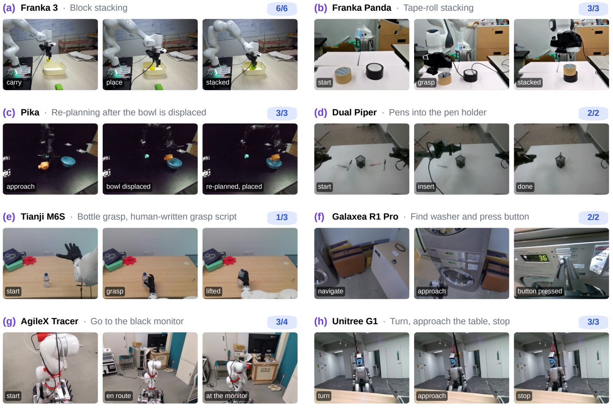

*该报告 Figure 8，第 12 页原图：八种真机配置中的示例。角标为成功次数／尝试次数；(e) 使用人工编写的抓取脚本。图中展示的任务不能代表各平台全部测试。*

真机结果更能说明边界：刚体取放为 17/18，而三种平台上的插头插入合计为 0/11。G1 实验也验证了 Astra 可以通过已有底层控制接口完成部分任务，省去专门训练的中间动作策略；但作者将其限定为慢速反馈监督下的可行性，尚未建立可靠的实时视觉运动控制。[§4.2–4.3，第 12–13 页](https://arxiv.org/pdf/2610.22471v2#page=12)

**本文的分析是，动作策略可以被替代，执行责任仍须有人承担。** 假设机器人要插入一个插头，上层模型可以判断插孔位置、选择接近方向，甚至给出接下来的末端目标；执行系统仍需及时处理位置误差、接触和电机状态。这些功能将来可以合并进一个模型，也可以由多个模块协作，但模型名称或模块数量不能替代对这些功能的验证。

因此，System 0 不应被理解为永远不可学习、不可合并的固定模块。它提示的是一个持续存在的要求：物理过程发生时，系统必须及时给出有效反馈。未来模型若能在所需时间尺度上完成这些工作，分层可以改变；证明这一点需要相应的闭环实验。

### 7.9 OpenAI 的团队重组，以及后续模型可能改变的方向

Fortune 于 2026 年 11 月 13 日报道，OpenAI 撤销独立机器人团队，人员转入其他团队。[报道原文](https://fortune.com/2026/11/13/openai-disbands-robotics-team-as-its-general-models-start-running-robots/)

这条消息属于组织层面的变化。本文将它视为观察研发路线的背景，不把它当作“机器人问题已经解决”的实验依据。组织如何分工，与系统能否完成真实任务，需要分别判断。

结合前面的实验，后续发展值得沿着三条路径观察。**以下是本文的情景分析，不是厂商已经实现的能力或公开路线图。**

| 可能的发展 | 对现有分工的影响 | 需要怎样的证据 |
| --- | --- | --- |
| 通用模型更准确、更快地理解空间并生成动作目标 | 越来越多任务可能不再需要专用的中间动作策略 | 在相同观察、示范、工具和时间预算下，持续优于原有系统 |
| 通用模型生成或改进小型策略，再部署到机器人上 | 大模型参与研发和适应，快速策略承担持续执行 | 学到的策略在新场景真机上有效，并能减少适应成本 |
| 模型直接利用连续视觉、触觉和本体反馈 | 推理、动作与反馈控制的边界进一步合并 | 在环境持续变化时仍能及时响应，并处理接触、失败和长任务 |

“更强的大模型”也可能通过改进仿真、数据处理、控制代码和实验设计，加快具身研发。这条间接路径同样值得重视：即使线上执行仍保留小模型和控制器，大模型也可能显著改变它们被训练和改进的方式。其效果应通过研发周期、数据需求和真机表现来测量。

回到 GR00T 2，下一步更有价值的问题是：**在什么任务、时间预算和硬件条件下，还需要专门的 WAM／VLA？** 如果通用模型能以更少适应成本可靠完成某类操作，专用策略就需要说明自身在速度、精度、成本或部署条件上的价值；若任务要求密集接触反馈，则应比较整套系统在该条件下的表现。

本文当前的判断是：通用模型已经开始改变具身系统的技术分工，甚至可以在部分实验中绕过专用动作策略。是否足以“击穿”整个具身问题，则要继续检验陌生任务、持续运行的物理环境、完成时间和人工干预次数。未来版本值得期待，结论应随着这些证据更新。

## 8. 研究结论与开放问题

### 8.1 实验支持了什么

GR00T 2 说明，联合预测视频与动作能够形成一条利用异构经验的技术路线。在本文的训练配方和任务中，人类数据有助于机器人表现，跨身体经验能减少部分新任务的示范需求，执行反馈还能继续提高接触技能的成功率。

它也展示了这些能力怎样进入实际系统：上层智能体组织任务、检查和恢复，底层策略执行操作，运行时与控制器负责把动作连续地落到机器人上。每一层都提供了一部分能力；评价时需要保留相应的实验条件与系统组成。[§5，第 26–28 页](https://research.nvidia.com/labs/gear/gr00t-2/assets/gr00t2_whitepaper.pdf#page=26)

### 8.2 哪些问题仍待解决

| 尚未解决的问题 | 为什么它影响下一步研究 |
| --- | --- |
| 应该预测什么未来、用多高分辨率、预测多远 | 视频 token 占用大量计算；哪些细节对动作真正必要仍不清楚 |
| 视频预测主要帮助训练，还是也帮助推理 | 联合预测有效，不等于已分离出每种作用的贡献 |
| 怎样加入记忆、力和触觉 | 模型只观察约 0.8 秒历史；当前力相关能力主要体现在输出，触觉尚未作为输入 |
| 各类数据怎样换算成机器人能力 | 人类视频、UMI、遥操作、失败恢复数据的边际价值没有统一答案 |
| 怎样确认任务真正完成 | 上层视觉判断也会漏掉半拧入的螺丝等细微物理失败 |
| 怎样持续学习，同时控制成本 | 新任务仍需要数据、评估、场景复位和适配；模型与数据版本还必须可追溯 |

这些问题来自论文结论部分。它们连接到具体的部署困难：长任务需要记忆，精细接触需要更合适的感知与控制接口，高成功率需要足够的评估次数，在线改进需要能长期重复操作和自动复位的设备。[§5，第 26–28 页](https://research.nvidia.com/labs/gear/gr00t-2/assets/gr00t2_whitepaper.pdf#page=26)

上层智能体本身也可能成为等待来源。YAM 视觉引导垃圾分类实验中，智能体一轮调用的中位耗时约 7.5 秒，机器人在一段任务中等待智能体的时间占比中位数约为 38%。这说明整体吞吐量需要沿着整条执行链检查；仅缩短 WAM 的预测延迟，还不足以保证任务更快。[§5，第 28 页](https://research.nvidia.com/labs/gear/gr00t-2/assets/gr00t2_whitepaper.pdf#page=28)

### 8.3 阅读自测

理解这套方法后，可以用以下问题检查各个技术环节是否已经连贯起来。

1. 解释一次动作生成：相机、语言、机器人状态分别怎样进入模型？未来视频和动作在哪里发生联系？
2. 解释一次迁移：放滤纸实验中，哪些信息来自人类示范，哪些来自目标机器人的通用操作数据？
3. 解释一个百分比：Dexter-50 的 95% 对应什么任务筛选、示范数量和适应方法？它不能回答哪些问题？
4. 解释一次改进：GRPO、自模仿和 Residual RL 分别更新什么？自模仿的初始权重来自哪里？
5. 解释一次长任务：智能体怎样调用技能、发现失败和恢复？任务成功由哪个环节验收？
6. 解释一次部署：预测延迟、动作段衔接和任务完成时间为什么要分别测量？
7. 比较两种分层架构：为什么不能只根据 System 1 或 System 0 的名称判断模块职责？目标、动作和反馈分别通过什么接口传递？
8. 判断一次“通用模型突破”：模型、运行框架、示范和预算分别改变了什么？如果省去专用动作策略，哪些执行功能仍由其他模块承担？

作为延伸练习，可以选择一个具体操作任务，写清输入、动作空间、示范来源、成功标准和常见失败，再逐项分析：增加示范能补充什么信息，数据对齐解决什么差异，后训练改善什么动作，恢复机制又处理哪些异常。这个练习有助于把论文方法对应到实际问题上。

GR00T 2 的研究价值，在于把经验来源、动作学习和系统执行之间的关系呈现得更具体。判断这类方法时，既要看模型能够完成哪些任务，也要追踪它使用了什么数据、接受了怎样的适应、依赖哪些外部模块，以及成功率是在什么条件下测得的。

---

## 参考资料

NVIDIA. [GR00T 2: Scaling Robot Foundation Models for Generalization, Dexterity, and Adaptation](https://research.nvidia.com/labs/gear/gr00t-2/assets/gr00t2_whitepaper.pdf). 2026.

[GR00T 2 官方项目主页](https://research.nvidia.com/labs/gear/gr00t-2/)

原论文阅读索引：模型结构见 §2，能力实验见 §3，训练、数据与系统见 §4，开放问题见 §5。少样本适应、强化学习和智能体的实现细节分别见附录 A.3、F、G。
